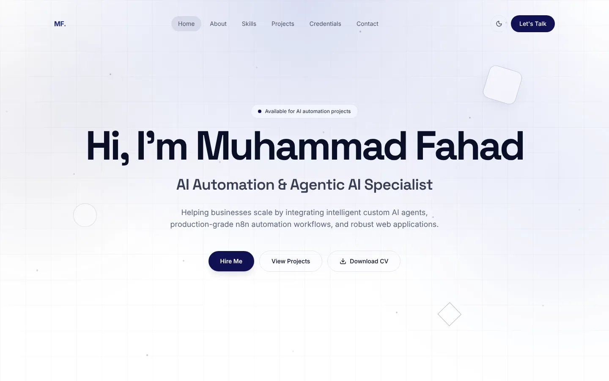
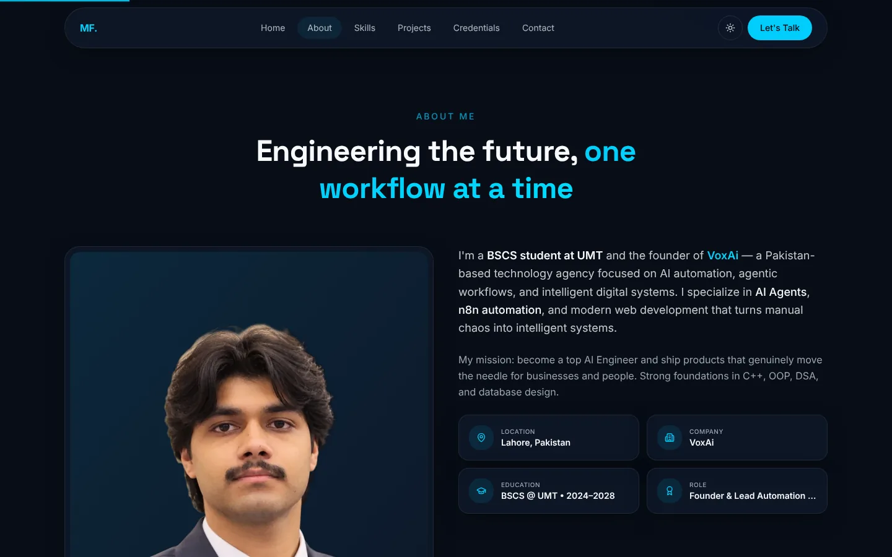
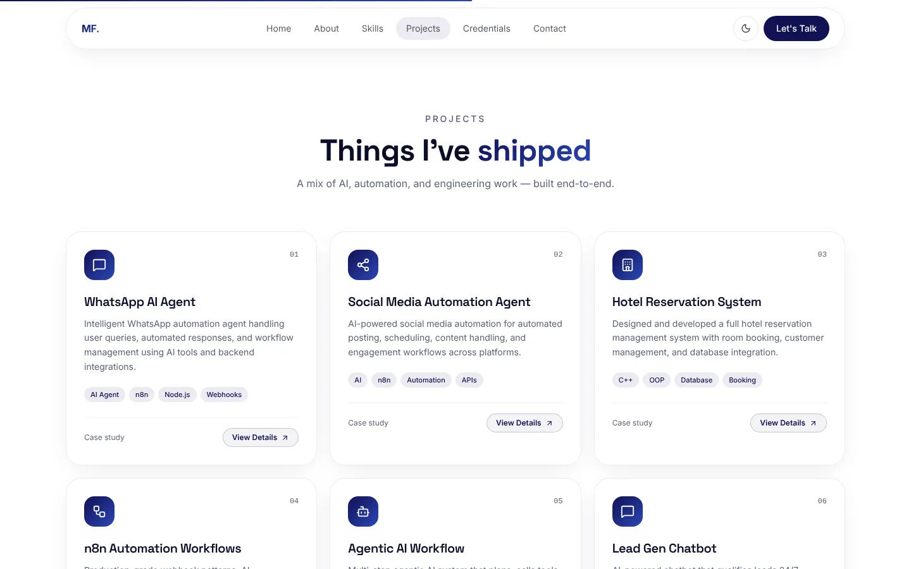

<div align="center">

# Muhammad Fahad

**AI Automation & Agentic AI Specialist** · Founder of VoxAi · BSCS @ UMT

Personal portfolio showcasing my work in AI agents, n8n automation workflows, and modern web development.

[](https://portfolio-fahad-offcl.vercel.app)
[](public/Muhammad_Fahad_Resume.pdf)

[](https://react.dev)
[](https://www.typescriptlang.org)
[](https://vitejs.dev)
[](https://tailwindcss.com)
[](https://motion.dev)
[](https://vercel.com)

<br />



</div>

<br />

## About

I'm a Computer Science student at the University of Management and Technology (UMT), Lahore, and the
founder of **VoxAi** — an agency building AI automation, agentic workflows, and intelligent digital
systems for businesses. This site is where I present my projects, skills, and credentials, and where
clients can reach me directly.

## Highlights

- **Light & dark themes** — follows the visitor's system setting and remembers their choice.
- **Polished motion** — staggered scroll reveals, blur-in hero, mouse-reactive background, custom cursor and a scroll progress bar, built with Framer Motion.
- **Fully responsive** — designed for phones, tablets and large screens, with a dedicated mobile menu.
- **Working contact form** — schema-validated with Zod, delivered straight to my inbox, with a honeypot to filter spam bots.
- **One-click resume download** — available from the hero and the contact section.
- **Content-driven architecture** — every piece of text, link, skill, project and credential lives in a single typed data file, so content updates never touch layout code.
- **Lightweight & accessible** — no heavy 3D libraries, lazy-loaded imagery, semantic HTML, and reduced-motion support.

## Screenshots

<table>
  <tr>
    <td width="50%"></td>
    <td width="50%"></td>
  </tr>
  <tr>
    <td align="center"><sub>About — dark mode</sub></td>
    <td align="center"><sub>Projects</sub></td>
  </tr>
</table>

## Sections

| Section | What it covers |
| --- | --- |
| **Home** | Introduction, availability status, and quick links to hire me, view projects, or download my CV |
| **About** | Background, mission, and key facts — location, company, education, role |
| **Skills** | Languages, AI / agentic AI, automation, web, backend, tools, platforms, and CS foundations |
| **Projects** | WhatsApp AI agent, social media automation, n8n workflows, agentic AI systems, and more |
| **Credentials** | Professional milestones and education |
| **Contact** | Email, WhatsApp, resume, social links, and a contact form |

## Tech Stack

| Area | Technology |
| --- | --- |
| Framework | React 18 + TypeScript |
| Build tool | Vite |
| Styling | Tailwind CSS v4 with a custom design-token theme |
| Animation | Framer Motion |
| Icons | Lucide |
| Validation | Zod |
| Form delivery | FormSubmit |
| Hosting | Vercel (auto-deploys on every push to `main`) |

## Project Structure

```text
├── docs/                       README screenshots
├── public/
│   ├── fahad.webp              profile photo
│   └── Muhammad_Fahad_Resume.pdf
└── src/
    ├── data/portfolio.ts       all site content (single source of truth)
    ├── index.css               theme tokens, light/dark palettes, custom utilities
    ├── App.tsx                 page composition and section order
    ├── hooks/useTheme.ts       theme switching and persistence
    └── components/
        ├── Navbar, Footer, Loader, ScrollProgress, CustomCursor
        ├── BlurFade, SectionLabel, BrandIcons
        └── sections/           Hero, About, Skills, Projects, Credentials, Contact
```

<details>
<summary><strong>Updating content</strong></summary>

<br />

| To change… | Edit |
| --- | --- |
| Text, links, skills, projects, credentials | `src/data/portfolio.ts` |
| Profile photo | Replace `public/fahad.webp` |
| Resume | Replace `public/Muhammad_Fahad_Resume.pdf` (same file name) |
| Colors for light / dark mode | `:root` and `.dark` at the top of `src/index.css` |
| Section order | `src/App.tsx` |
| Where contact messages are delivered | `formEmail` in `src/data/portfolio.ts` |

Adding a project, skill group or credential is a matter of copying an existing entry in
`src/data/portfolio.ts` and editing it — the page renders whatever the lists contain.

</details>

## Contact

- **Email:** [muhammadfahad.offcl@gmail.com](mailto:muhammadfahad.offcl@gmail.com)
- **WhatsApp:** [+92 304 4782376](https://wa.me/923044782376)
- **LinkedIn:** [linkedin.com/in/muhammad-fahad-275aa5390](https://linkedin.com/in/muhammad-fahad-275aa5390)
- **GitHub:** [github.com/MuhammadFahad-offcl](https://github.com/MuhammadFahad-offcl)

Available for AI automation projects and collaborations.

## License

© 2026 Muhammad Fahad. All rights reserved.

The source code may be viewed for learning purposes. The design, written content, photographs and
resume may not be reused or redistributed without permission.
